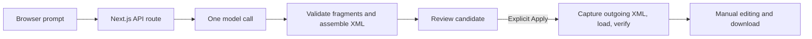

# AI Diagram Studio

Generate editable architecture diagrams from natural-language descriptions, review
them before applying, and refine them directly in draw.io. AI Diagram Studio is a
focused local web application that combines model-generated diagrams with explicit
user approval and full-document preservation.

## Features

- Generate small architecture diagrams with labeled nodes and directed connectors.
- Review a validated candidate before applying, downloading, or discarding it.
- Continue editing the current diagram while generation is running.
- Preserve a fresh outgoing snapshot before replacement and verify the loaded result.
- Restore the previous version, including manual shapes, styles, and geometry.
- Capture, reload, and download editable `.drawio` XML.
- Cancel generation and retry explicitly, with deadlines and stale-response protection.

## Architecture

The application uses Next.js, React, and TypeScript. An embedded diagrams.net
editor supplies the drawing interface. The server uses the OpenAI Responses API;
Zod validates JSON contracts, saxes parses XML, and xmlbuilder2 assembles documents.
Vitest, Testing Library, and jsdom provide automated tests.



The API route owns credentials and provider integration. Framework-independent
functions handle generation orchestration, XML validation, and document-state
transitions. The browser coordinates candidates and history; the iframe owns the
live drawing. Full editor XML remains the source of truth, so manual work is not
reconstructed from a simplified graph.

## Engineering decisions

**Validate before replacement.** Model output is untrusted. Generated cells must
satisfy limits on IDs, references, geometry, styles, labels, and document size.
The application supplies the document shell and validates the serialized result.
Invalid or partial output is rejected without an automatic repair loop.

**Separate generation from preservation.** Generated diagrams use a narrow
allowlist. Manual editing can introduce richer draw.io content, which follows
separate preservation checks. Supported manual XML is retained intact.

**Verify Apply and Restore.** Replacement briefly blocks editor interaction,
captures and retains the latest outgoing XML, loads the target, and compares a
fresh export with the intended document. History changes only after verification.
An uncertain load retains recovery XML and requires an editor retry. Restore also
saves its outgoing version, making a single restore reversible.

**Bound asynchronous work.** Generation has a 45-second server budget and a
50-second browser budget. Provider retries are disabled. Request ownership prevents
late responses or cleanup from changing a newer attempt. Editor messages are
filtered by origin and iframe window; timed-out sessions are invalidated.

## Getting started

Requirements: Node.js 24, npm, internet access for the hosted diagrams.net editor,
and an OpenAI API key for generation. `.nvmrc` pins the Node version.

```sh
nvm install
nvm use
npm ci
cp .env.example .env.local
```

Set `OPENAI_API_KEY` in `.env.local`, then start the application:

```sh
npm run dev
```

Open <http://127.0.0.1:3000>. Describe a system, generate a candidate, and select
Apply when ready. Make manual edits in the embedded editor, then use Download to
save them. The key stays on the server; never use a `NEXT_PUBLIC_` variable for it
or commit `.env.local`. Generation uses your provider account and may incur charges.
Manual editing and deterministic tests do not require a key.

## Verification

```sh
npm test
npm run typecheck
npm run build
```

After building, `npm start` runs the production server locally. The automated suite
covers validation, escaped text, rich-document preservation, API errors, request
cancellation, duplicate actions, stale responses, replacement verification, and
failure recovery. Tests use controlled iframe messages and mocked provider
responses; they do not establish compatibility with the live hosted editor or
prove model quality.

## Limitations

This is a local prototype, not a hosted multi-user service. History exists only in
memory and is lost on a full-page refresh; download work you want to retain.
Generation supports one page with 3–12 nodes and at most 24 directed edges.
Multi-page recovery is unsupported, although safely bounded multi-page XML can be
downloaded intact. Structural validation does not guarantee a correct architecture
or readable layout. The editor requires an external service, and cancellation
cannot guarantee that already-started model usage is unbilled.

## License

[MIT](LICENSE).
